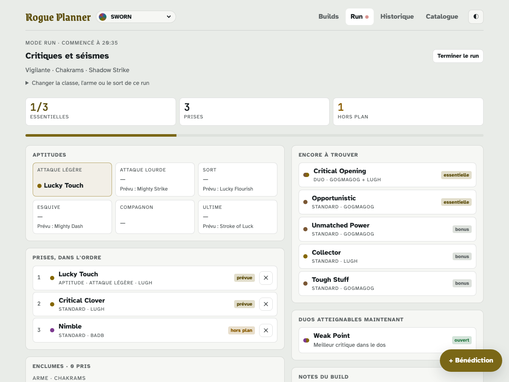
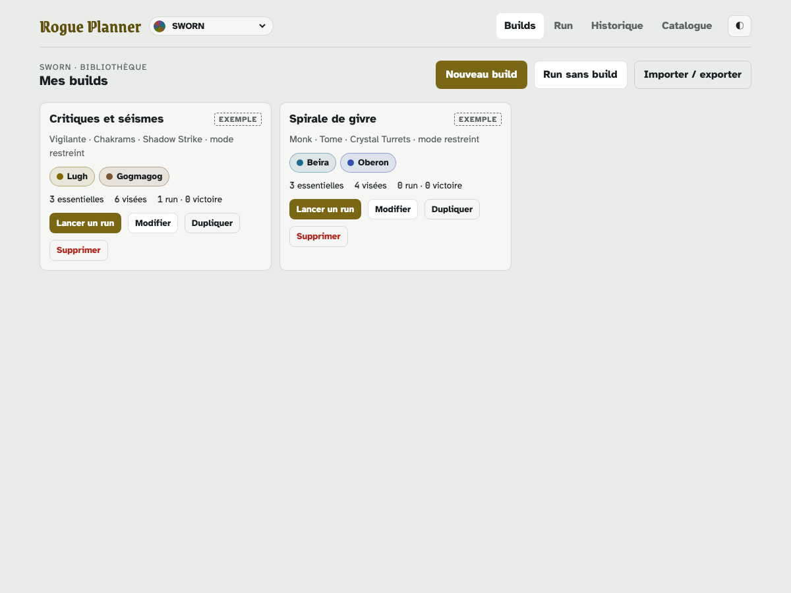
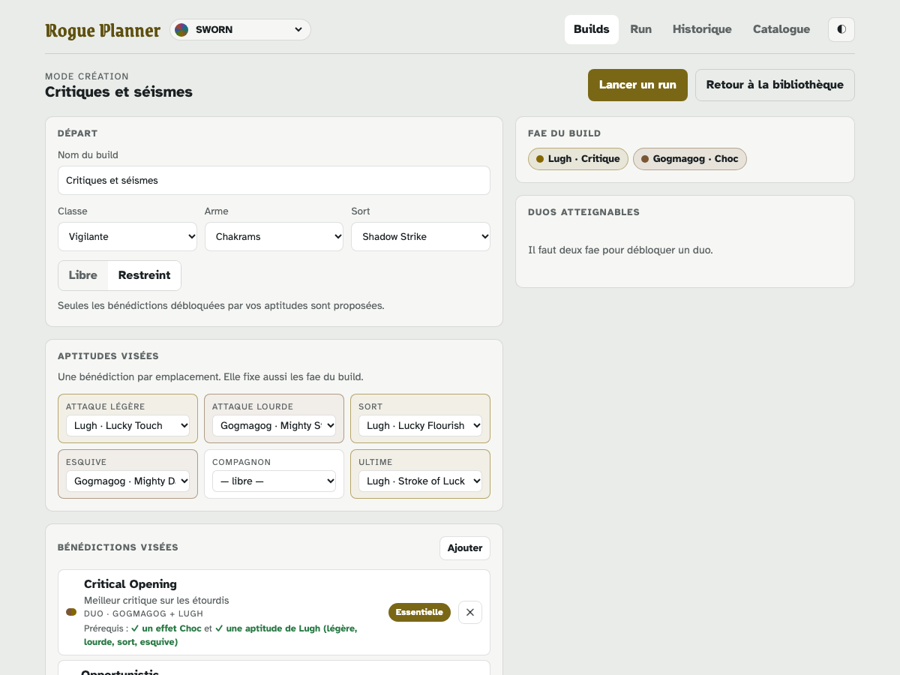
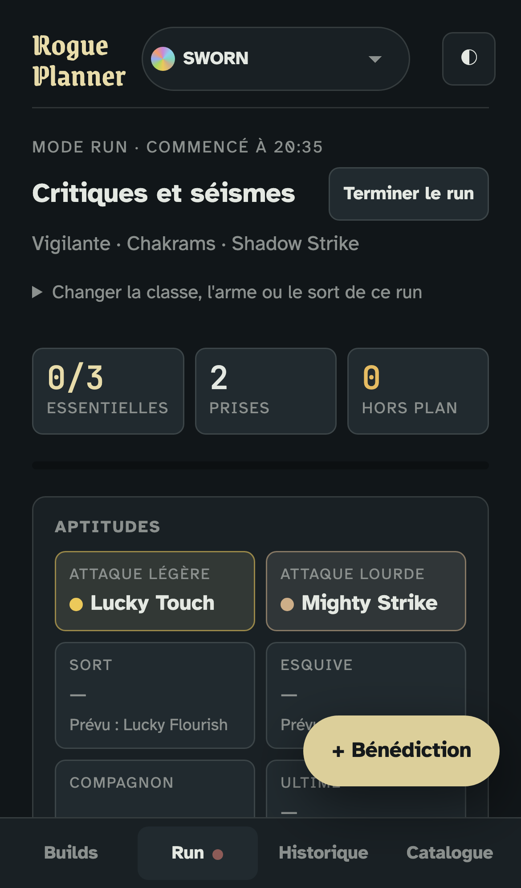
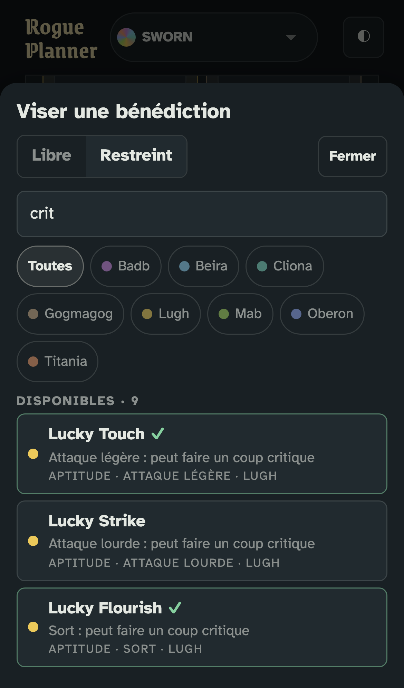

# Rogue Planner

Planner de builds pour jeux rogue-like, sur ordinateur et sur mobile. Premier jeu : **SWORN**.

Préparez vos builds (aptitudes, bénédictions visées, duos, enclumes), puis suivez votre partie en direct :
notez chaque bénédiction prise, l'outil montre l'écart au plan, ce qui reste à trouver et les duos qui s'ouvrent.

**▶ Utiliser : <https://nelsio.github.io/rogue-planner/>**, ou téléchargez `rogue-planner.html` depuis la
[dernière release](https://github.com/nelsio/rogue-planner/releases/latest) : un seul fichier, qui marche hors ligne.
Vos données restent dans votre navigateur ; l'export JSON permet de les sauvegarder ou de changer d'appareil.



| Bibliothèque | Création |
|---|---|
|  |  |

| RUN sur mobile | Sélecteur en mode restreint |
|---|---|
|  |  |

## Ce que fait la v0.1

- **Bibliothèque** de builds : créer, dupliquer, supprimer, lancer un run.
- **Création** : classe, arme, sort ; mode **Libre** ou **Restreint** (seules les bénédictions débloquées) ;
  prérequis en vert ✓ ou en orange ; duos atteignables ; enclumes ; notes.
- **RUN** : prises dans l'ordre, essentielles, hors plan, emplacements, encore à trouver, duos ouverts, fin du run.
- **Historique** filtrable, **Catalogue** des 256 bénédictions, ajout d'une bénédiction manquante.
- **Import / export** JSON par fusion. Thème clair, sombre ou automatique.

Mode d'emploi : [docs/GUIDE.md](docs/GUIDE.md).

## Développer

```sh
npm install
npm run dev        # serveur de développement
npm test           # tests Vitest (moteur, stockage, interface)
npm run e2e        # scénarios Playwright (npx playwright install au premier lancement)
npm run build      # produit dist/rogue-planner.html
node scripts/screenshots.mjs   # régénère les captures de docs/img (après un build)
```

Architecture, modèle de données et choix de chaque lot : [HANDOFF.md](HANDOFF.md). Une donnée de jeu fausse ?
Corrigez `src/games/sworn/pack.json` et lancez `npm test` (HANDOFF §4.5).

## Licences

Code sous licence MIT. Données SWORN tirées du [SWORN Wiki](https://sworn-game.fandom.com/) (Fandom),
sous CC BY-SA 3.0. Polices sous licence OFL. Détails dans [docs/CREDITS.md](docs/CREDITS.md).

Projet de fan non affilié. SWORN est une marque de ses éditeurs (Team17, Windwalk Games).
